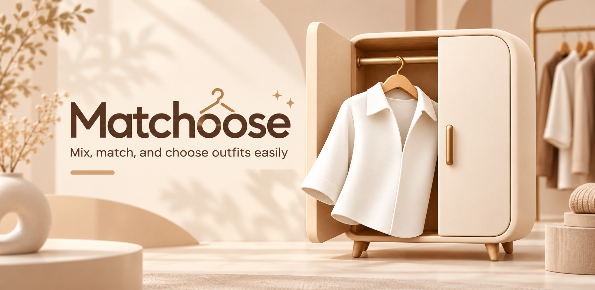

  <strong>Mix, match, and choose outfits easily.</strong>

  A personal digital wardrobe and outfit matching application.

  

---

## About

**Matchoose** is a wardrobe management application designed to make organizing clothes and choosing outfits easier.

Users can build their own digital wardrobe, explore different clothing combinations, and receive outfit recommendations based on the clothes they already own.

## Features

- **Digital Wardrobe** — Organize and manage clothing items in one place.
- **Add Clothing** — Take photos or import images from your gallery.
- **Outfit Recommendations** — Discover matching outfits based on color compatibility and clothing style.
- **Mix & Match** — Combine different clothing items to create outfits.
- **Save Outfits** — Save your favorite combinations for future use.
- **Smart Search** — Find clothing by name, category, color, style, or favorites.
- **Favorites** — Mark your favorite clothing items for quick access.
- **Multilingual Support** — Available in English, Thai, and Simplified Chinese.
- **Customizable Settings** — Adjust application language and font size.

## How It Works

1. **Add Your Clothes** — Take photos or upload images of your clothing items.
2. **Organize Your Wardrobe** — Categorize clothes by type, color, and style.
3. **Get Recommendations** — Discover outfit combinations based on clothing compatibility.
4. **Mix & Match** — Experiment with different clothing combinations.
5. **Save Your Outfits** — Keep your favorite combinations for later.

## Outfit Recommendation System

Matchoose uses a rule-based recommendation system to suggest suitable clothing combinations.

The system evaluates three main factors:

- **Color Harmony** — Matches clothing based on compatible color combinations.
- **Style Compatibility** — Pairs clothing items with matching styles.
- **Personal Preferences** — Takes favorite clothing items into account when generating recommendations.

## Download

Matchoose is available for Android on Google Play.

**[Download Matchoose on Google Play](https://play.google.com/store/apps/details?id=com.mottech.matchoose)**

---

  <strong>Matchoose</strong>
   
  Make the most of your wardrobe.

